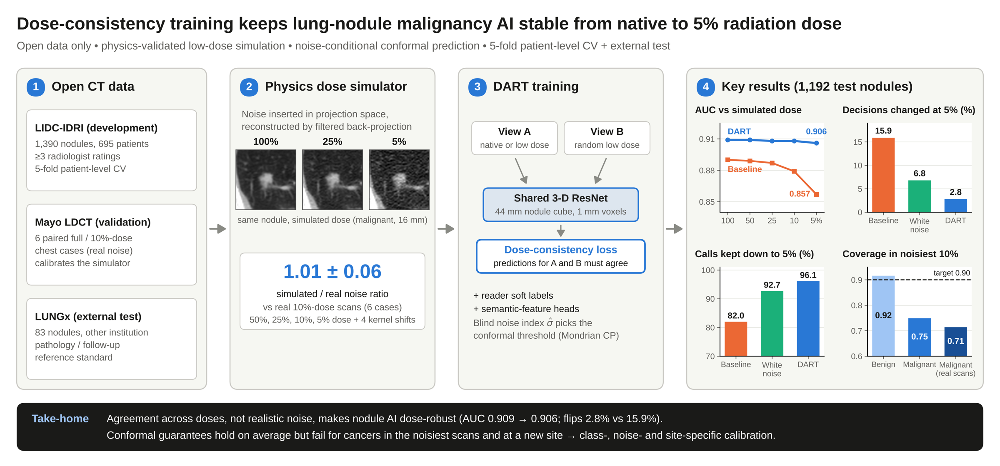

# DART-Nodule: dose-robust lung nodule classification with noise-conditional conformal prediction

Code and output data for the study:

> **Dose-consistency training, not noise realism, stabilizes lung nodule malignancy AI across radiation dose: a physics-validated study with noise-conditional conformal prediction on open CT data.**
> Asaduzzaman, Tzu-Sen Yang, *et al.* Manuscript in submission (2026).

DART-Nodule (a **d**ose-**a**ware, **r**eliability-**t**argeted nodule classifier) asks two questions on open CT data only:

1. Can a 3-D nodule-malignancy classifier be made robust to radiation dose, and does that need physically realistic low-dose noise?
2. Do conformal prediction sets keep their guaranteed error rate when the dose changes, and does conditioning on an image-derived noise index help?



## Main findings

| | Baseline | White-noise aug. | DART |
|---|---|---|---|
| AUC, native dose | 0.890 | 0.902 | **0.909** |
| AUC, 5 % dose | 0.857 | 0.891 | **0.906** |
| Decisions changed, native → 5 % dose | 15.9 % | 6.8 % | **2.8 %** |
| Calls kept down to 5 % dose (8–<15 mm nodules) | 74.4 % | 89.5 % | **93.9 %** |
| LUNGx external AUC (mean ± SD, 5 fold models) | 0.58 ± 0.08 | 0.60 ± 0.02 | 0.62 ± 0.03 |

* The projection-domain simulator reproduced real 10 %-dose noise (simulated/real noise ratio 1.01 ± 0.06 on six Mayo chest cases).
* The **dose-consistency loss**, not realistic noise, produced most of the robustness gain.
* Conformal coverage stayed near its 0.90 target on average, but fell to 0.79–0.88 in the noisiest 10 % of scans, mostly on malignant nodules. Noise-conditional (Mondrian) calibration repaired this only partly, and coverage fell to about 0.60 on the external LUNGx data.

All numbers are pooled over the test folds of 5-fold patient-level cross-validation (1,192 LIDC-IDRI nodules with a definite label) and can be checked against the files in [`outputs/`](outputs).

## Repository structure

```
dart/                 core library
  ct_physics.py         parallel-beam projector, FBP, projection-domain low-dose noise insertion, kernel proxies
  noise_estimator.py    blind noise index (robust MAD of a 4-neighbor residual)
  bank.py               simulated acquisition bank (native + 4 low doses x 2 realizations + 4 kernel conditions = 13)
  model.py              3-D ResNet with optional semantic heads
  conformal.py          split, pooled, noise-Mondrian and noise x class Mondrian conformal prediction
  metrics.py            AUC, ECE, Brier score, patient-clustered bootstrap
  lidc_xml.py, dicom_io.py, data.py, utils.py, figs1.py
scripts/              numbered pipeline (00-10), see below
configs/default.yaml  all paths and hyper-parameters
tests/                synthetic LIDC-like data generator for a quick dry run
outputs/              results of the full run reported in the paper
  results/              metrics tables (.csv/.md), summary.json, noise_validation.json
  results/extra/        dose tolerance, conformal repair and semantic-fragility analyses
  results/figures/      all figures (800 dpi PNG)
  preds/                per-nodule test/validation/calibration predictions, every variant x fold x condition
  logs/                 training curves per variant and fold
  tables/               nodule cohort tables (LIDC-IDRI, LUNGx), noise index per condition, CV splits
docs/                 pipeline overview image
```

## Data

The imaging data are **not** redistributed here. Download them from The Cancer Imaging Archive (TCIA) with the NBIA Data Retriever and point `configs/default.yaml` to them (the defaults expect a `data/` folder next to this README):

| Dataset | Role | DOI |
|---|---|---|
| LIDC-IDRI (CT + XML annotations) | development, 5-fold CV | [10.7937/K9/TCIA.2015.LO9QL9SX](https://doi.org/10.7937/K9/TCIA.2015.LO9QL9SX) |
| SPIE-AAPM-NCI Lung Nodule Classification Challenge (LUNGx) | external test | [10.7937/K9/TCIA.2015.UZLSU3FL](https://doi.org/10.7937/K9/TCIA.2015.UZLSU3FL) |
| Low Dose CT Image and Projection Data (Mayo, chest cases C002, C004, C012, C016, C021, C027) | simulator validation | [10.7937/9npb-2637](https://doi.org/10.7937/9npb-2637) |

Use of these data must follow the TCIA data usage policies and the license of each collection.

## Installation

Developed on Windows with Python 3.12, PyTorch (CUDA) and an NVIDIA RTX 5060 Laptop GPU (8 GB). Linux works the same way.

```bash
python -m venv .venv
# Windows: .\.venv\Scripts\Activate.ps1      Linux/macOS: source .venv/bin/activate
python -m pip install --upgrade pip
# 1) PyTorch with CUDA: use the command from https://pytorch.org/get-started/locally/ , e.g.
pip install torch --index-url https://download.pytorch.org/whl/cu124
# 2) everything else
pip install -r requirements.txt
python scripts/00_check_env.py      # should report CUDA available and your GPU
```

Quick dry run without downloading anything:

```bash
python tests/make_synthetic_lidc.py --out data/synthetic --patients 24
# then set lidc_root and lidc_xml_root in configs/default.yaml to data/synthetic
```

## Reproducing the study

Run the steps in order from the repository folder (or `.\run_all.ps1` on Windows). Every script takes `--config configs/default.yaml`.

| Step | Script | What it does | Main output (in `work/`) |
|---|---|---|---|
| 0 | `00_check_env.py` | checks GPU, PyTorch and simulator speed | console |
| 1 | `01_index_lidc.py` | parses LIDC XML, groups reader outlines into nodules, reads acquisition metadata | `tables/nodules.csv` |
| 2 | `02_build_bank.py` | simulates every nodule at native, 50/25/10/5 % dose and 4 kernel conditions, computes the noise index | `bank/`, `tables/bank_sigma.csv` |
| 3 | `03_train.py` | trains the 6 ablation variants x 5 folds (`--variants`, `--folds` to subset) | `models/`, `preds/`, `logs/` |
| 4 | `04_evaluate.py` | discrimination, calibration, flip rates, paired bootstrap tests, conformal prediction | `results/` |
| 5 | `05_lungx_external.py` | external test on LUNGx (with QC images of every nodule) | `results/lungx_*.csv` |
| 6 | `06_validate_noise_sim.py`, `06b_figure_S1.py` | compares simulated with real 10 %-dose noise on the Mayo cases, calibrates the photon-count constant | `results/noise_validation.json`, `figS1_*.png` |
| 7 | `07_example_figure.py` | example nodules under every acquisition | `fig1_acquisition_examples.png` |
| 8 | `08_conformal_figures.py` | coverage and reliability figures | `fig2`-`fig6` |
| 9 | `09_extra_analyses.py` | per-nodule dose tolerance, conformal repair, semantic-feature fragility | `results/extra/`, `fig7`-`fig9` |
| 10 | `10_graphical_abstract.py` | pipeline overview image | `graphical_abstract.*` |

The full run builds a bank of 1,390 nodules x 13 conditions and trains 30 models (6 variants x 5 folds) on a single laptop GPU. The simulated bank needs about 7 GB of disk space.

### Variants (ablation ladder)

| Variant | Acquisition augmentation | Dose consistency | Labels | Semantic heads |
|---|---|---|---|---|
| `baseline` | none | – | hard | – |
| `gauss` | image-domain white noise, σ ~ U(10,110) HU | – | hard | – |
| `physics` | projection-domain bank | – | hard | – |
| `physics_cons` | physics | λ = 1 | hard | – |
| `physics_cons_soft` | physics | λ = 1 | soft (reader vote) | – |
| `dart` | physics | λ = 1 | soft | 6 heads, weight 0.2 |

## Output files and the paper

| Paper item | File in `outputs/results/` |
|---|---|
| Table 3 (AUC per variant and acquisition) | `table_auc.md`, `discrimination.csv` |
| Table 4 (paired ΔAUC) | `paired_auc_tests.csv`; flip-rate tests in `paired_flip_tests.csv` |
| Table 5a/5b (conformal coverage) | `table_conformal_dart_alpha0.1.md`, `conformal_by_noise_stratum.csv` |
| Table 6 (LUNGx) | `lungx_auc_summary.csv`, `lungx_conformal_per_fold.csv` |
| Table 7 (dose tolerance by size) | `extra/dose_tolerance_by_size.csv` |
| Fig. 1 | `figures/fig1_acquisition_examples.png` |
| Fig. 2 | `figures/fig4_sigma_by_condition.png` |
| Fig. 3 | `figures/fig2_auc_vs_dose.png` |
| Fig. 4 | `figures/fig5_reliability.png` |
| Fig. 5 | `figures/fig3_conformal_alpha0.1.png` |
| Fig. 6 | `figures/fig6_coverage_by_noise_alpha0.1.png` |
| Fig. 7–9 | `figures/fig7_dose_tolerance.png`, `fig8_conformal_repair.png`, `fig9_semantic_dose.png` |
| Online Resource 1 (simulator validation) | `figures/figS1_noise_validation.png`, `noise_validation.json` |

Each prediction file in `outputs/preds/` has one row per nodule × split × acquisition condition, with the calibrated probability (`prob`), logit, temperature (`T`), blind noise index (`sigma`), labels and the semantic-head outputs, so every metric in the paper can be recomputed without retraining.

## Citation

If you use this code or the outputs, please cite the paper (details will be added on publication):

```bibtex
@article{dartnodule2026,
  title   = {Dose-consistency training, not noise realism, stabilizes lung nodule malignancy AI across radiation dose: a physics-validated study with noise-conditional conformal prediction on open CT data},
  author  = {Asaduzzaman and Yang, Tzu-Sen and others},
  year    = {2026},
  note    = {Manuscript in submission}
}
```

## License

The code in this repository is released under the [MIT License](LICENSE). The derived output files are shared under the same terms; the underlying TCIA imaging data keep their own licenses.

## Acknowledgments

We thank the LIDC/IDRI consortium, the organizers of the SPIE-AAPM-NCI LUNGx Challenge, Mayo Clinic and The Cancer Imaging Archive for making the data publicly available.
